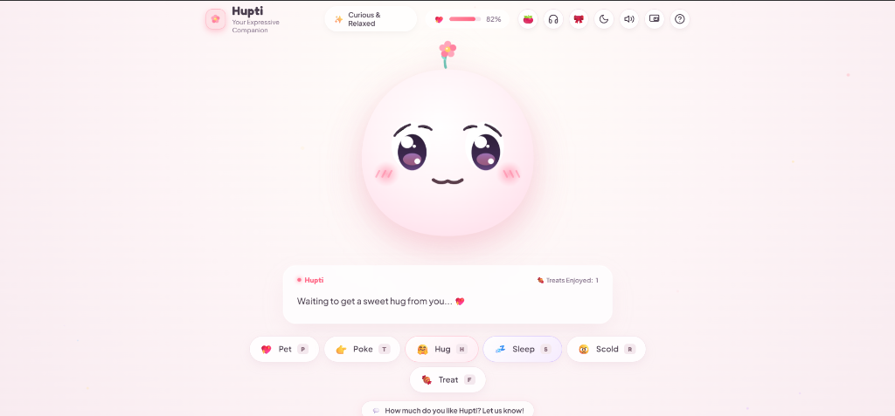

# 🌸 Hupti — The Expressive Virtual Pet Companion

[](https://hupti.vercel.app/)
[](https://github.com/RI-Rimon/Hupti)
[](https://developer.mozilla.org/en-US/docs/Web/JavaScript)
[](https://developer.mozilla.org/en-US/docs/Web/API/Web_Audio_API)
[](https://developer.chrome.com/docs/web-platform/document-picture-in-picture/)
[](https://github.com/RI-Rimon/Hupti)

> A minimalist, responsive, and heartwarming virtual companion that lives directly in your browser or floats over your desktop work. Crafted with fluid vector animations, procedural acoustic pet vocalizations, study companion tools, and zero external framework bloat.

<p align="center">
  
</p>

---

## 📑 Table of Contents

- [The Story Behind Hupti](#-the-story-behind-hupti)
- [Character Concept & Identity](#-character-concept--identity)
- [How Hupti Works (Architecture)](#-how-hupti-works-architecture)
- [Key Features](#-key-features)
- [Interactive Controls & Shortcuts](#-interactive-controls--shortcuts)
- [Technical Stack & Design Decisions](#-technical-stack--design-decisions)
- [Quick Start & Local Setup](#-quick-start--local-setup)
- [Future Roadmap & Ideas](#-future-roadmap--ideas)
- [Credits & Acknowledgments](#-credits--acknowledgments)

---

## 📖 The Story Behind Hupti

Hupti began during a late-night exam preparation session when studying for long hours started to feel overwhelming and monotonous.

The idea was to create a small companion that could sit quietly on the screen, respond to a little affection, and occasionally offer a comforting thought.

The concept, character identity, visual direction, emotional lifecycle, and overall architecture were planned as part of the project. AI-assisted coding tools, including Anti Gravity, helped with implementation and iterative refinement.

Hupti represents a personal experiment in combining frontend development, animation, browser audio, and thoughtful interaction design into a small but meaningful experience.

---

## 🌸 Character Concept & Identity

| Attribute | Specification |
| :--- | :--- |
| **Name** | **Hupti** (pronounced *Hup-tee*) |
| **Persona** | Affectionate, slightly playful, empathetic, and sweet companion. |
| **Visual Motif** | A 5-petal pink blossom with a golden pollen core—symbolizing fresh energy, soft resilience, and blooming warmth. |
| **Aesthetic** | Soft pastel minimalism (gentle strawberry blush, cream whites, lavender night shadows). |
| **Communication** | **100% Non-Verbal Vocalizations + Written Thoughts.** Dialogue appears in a clean typewriter subtitle card; audio is synthesized procedurally via oscillators. |

---

## 🧠 How Hupti Works (Architecture)

Hupti is engineered from the ground up without heavy external dependencies or runtime frameworks (such as React, Vue, or Three.js). The entire system relies on clean, modular Vanilla JavaScript conforming to the **Observer Pattern**.

```text
 ┌─────────────────────────────────────────────────────────────┐
 │                       USER INPUTS                           │
 │   Pointer Gestures (Forehead Stroke, Cheek Poke, Tap)       │
 │   Keyboard Shortcuts (P, T, H, S, W, R, F, M, O, B, C)      │
 │   Action Buttons & Tab Visibility (Document PiP Auto-Dock)  │
 └──────────────────────────────┬──────────────────────────────┘
                                │
                                ▼
 ┌─────────────────────────────────────────────────────────────┐
 │                      InputHandler.js                        │
 │   Normalizes pointer coordinates, tracks swipe distance,     │
 │   dispatches intent, and drives real-time pupil tracking    │
 └──────────────────────────────┬──────────────────────────────┘
                                │
                                ▼
 ┌─────────────────────────────────────────────────────────────┐
 │                       HuptiState.js                         │
 │   Central State Machine & Observer Hub                      │
 │   - Mood States: IDLE, HAPPY, HUGGED, POUTED, SAD, SLEEP    │
 │   - Pomodoro Study Engine (25m Focus / 5m Break Cycles)     │
 │   - Wardrobe Customization & Tint State Management          │
 │   - Autonomous Idle Chatter Timer (12–20s interval)         │
 │   - Affection Level (0–100%) & Treat Counter                │
 │   - LocalStorage State Persistence Engine                   │
 └──────┬───────────────────────┬───────────────────────┬──────┘
        │                       │                       │
        ▼                       ▼                       ▼
 ┌───────────────┐       ┌──────────────┐       ┌───────────────┐
 │HuptiRenderer  │       │  SoundFX.js  │       │ PiPManager.js │
 │- SVG morphing │       │- Web Audio   │       │- Document PiP │
 │- Accessories  │       │  Oscillators │       │- Video Stream │
 │- Study glasses│       │- Ambient Gen │       │  Fallback     │
 │- Eye tracking │       │  (Rain, LoFi,│       │- Bi-direction │
 │- Particle FX  │       │   Chimes)    │       │  State Sync   │
 └───────────────┘       └──────────────┘       └───────────────┘
```

### Module Breakdown:

1. **[`js/huptistate.js`](file:///c:/Users/redwa/OneDrive/Desktop/Test%20for%20antigravity/Vertual%20Pet/js/huptistate.js) — The Core State Machine:**
   - Governs Hupti's emotional model, affection percentages, and treat counts.
   - Manages the **Pomodoro Study Companion** cycle (25-minute focus sprints and 5-minute restorative breaks).
   - Tracks wardrobe accessories (Sakura, Sunflower, Snowdrop, Sprout, Scholar Cap, Ribbon), study eyewear, and body color tints.
   - Automatically serializes and reloads state to `window.localStorage` so your relationship with Hupti persists across browser sessions.

2. **[`js/huptirenderer.js`](file:///c:/Users/redwa/OneDrive/Desktop/Test%20for%20antigravity/Vertual%20Pet/js/huptirenderer.js) — Dynamic Visual Engine:**
   - Controls vector SVG rigging (morphing eye paths, dynamic sclera clipping, smiling/pouting mouth arcs, cheek blush opacities).
   - Renders interchangeable head accessories and wireframe study glasses 👓.
   - Dynamically updates body gradients and color palettes across light and dark modes.
   - Renders a lightweight HTML5 `<canvas>` particle engine for bursting floating hearts and falling strawberry mochi treats.
   - Implements spring-interpolated pupil tracking so Hupti's eyes smoothly follow your cursor.

3. **[`js/soundfx.js`](file:///c:/Users/redwa/OneDrive/Desktop/Test%20for%20antigravity/Vertual%20Pet/js/soundfx.js) — Procedural Web Audio Engine:**
   - Generates 100% of sound effects and ambient soundscapes dynamically using math and the browser's native `AudioContext`.
   - Utilizes `OscillatorNode` (sine, triangle), `BiquadFilterNode`, and exponential gain envelopes to synthesize soft purrs, chord swells, cute boops, celebratory fanfares, and infinite ambient textures (rain, wind chimes, hearth, lo-fi pads) without loading external audio assets.

4. **[`js/pipmanager.js`](file:///c:/Users/redwa/OneDrive/Desktop/Test%20for%20antigravity/Vertual%20Pet/js/pipmanager.js) — Always-on-Top Floating Companion:**
   - Implements the cutting-edge **Document Picture-in-Picture API** (`window.documentPictureInPicture`), enabling Hupti to float over desktop applications (VS Code, Word, Zoom, Discord, etc.).
   - Includes an offscreen HTML5 Canvas stream fallback (`canvas.captureStream()` → `video.requestPictureInPicture()`) for browsers that only support standard video PiP.
   - Bi-directionally synchronizes theme, mood, accessories, study glasses, Pomodoro countdown, and procedural audio.

5. **[`js/inputhandler.js`](file:///c:/Users/redwa/OneDrive/Desktop/Test%20for%20antigravity/Vertual%20Pet/js/inputhandler.js) & [`js/app.js`](file:///c:/Users/redwa/OneDrive/Desktop/Test%20for%20antigravity/Vertual%20Pet/js/app.js):**
   - Coordinates keyboard shortcuts, mouse/touch drag strokes on Hupti's forehead, cheek pokes, theme switching, typewriter dialogue transitions, Pomodoro controls, ambient soundscape playback, wardrobe styling, and feedback handling.

---

## 🚀 Key Features

### 1. ⤢ Picture-in-Picture Floating Mini Companion
- **Always-on-Top Floating Mode:** Click the PiP icon in the header or press shortcut **`O`** to pop Hupti into a dedicated floating window that stays on top of all desktop apps.
- **Fully Interactive in Mini View:**
  - Animated SVG face with real-time pupil tracking.
  - Live written subtitle thoughts card and Pomodoro countdown timer.
  - Interactive quick buttons (💖 Pet, 🤗 Hug, 💤 Sleep/Wake, 🍬 Treat).
  - Tapping her face directly inside the mini window triggers affectionate heart bursts.
- **Auto-Switch & Docking:** Hupti automatically transfers into floating mode when you switch browser tabs and seamlessly docks back when you return.

### 2. 🍅 Pomodoro Study Companion
- **Integrated Focus & Break Engine:**
  - Standard 25-minute study focus interval followed by a 5-minute rest and hydration break.
  - Interactive countdown pill in the header (`🍅 25:00 Focus`) and dedicated control modal.
  - Large digital countdown clock, Start/Pause, Reset, and Skip session controls.
  - **⭐️ Daily Counter:** Keeps track of how many focus sprints you have completed today.
  - **⚡ 1-Minute Quick Test Mode:** Quickly preview focus-to-break transitions in 60s and 15s.
- **Hupti Studies With You:**
  - During focus mode, Hupti puts on tiny **wireframe study glasses 👓**, tilts her head attentively, and gives encouraging study thoughts (*"Focus time started! Let's conquer this together. I'm right here studying beside you!"*).
  - When the focus sprint finishes, she plays a **celebratory fanfare chime**, takes off her glasses, floats happily with hearts, and reminds you to rest: *"Focus session complete! 🎉 Put your pen down, take a sip of water, and stretch your arms!"*

### 3. 🎧 Procedural Ambient Lo-Fi & Rain Soundscapes
- **Zero Audio Files:** 100% synthesized through the browser's native **Web Audio API**:
  - 🌧️ **Gentle Rain:** Cozy rolling rain hiss with delicate high-pitch droplets tapping on a window pane.
  - 🎐 **Zen Wind Chimes:** Ambient summer breeze carrying resonant pentatonic bells with realistic decays.
  - 🔥 **Cozy Hearth:** Deep warm low-frequency fireplace rumble with random micro-crackles and ember pops.
  - 🎵 **Lo-Fi Warm Pad:** Gentle undulating warm chords (Cmaj7, Am7, Fmaj7, G7sus) with tape flutter.
- Volume slider (0% to 100%) and instant Play/Stop toggle (Shortcut: **`B`**). Plays seamlessly in the background while studying or floating in PiP mode.

### 4. 🎀 Wardrobe, Custom Accessories & Seasonal Themes
- **Interactive Customizer Modal (Shortcut: `C`):**
  - **🌸 Head Accessories:** Sakura blossom, Golden Sunflower 🌻, Winter Snowdrop ❄️, Fresh Sprout 🌱, Scholar Graduation Cap 🎓, and Pastel Ribbon 🎀.
  - **👓 Eyewear:** Wireframe study glasses can be toggled manually or automatically worn during Pomodoro focus.
  - **🎨 Body Color Tints:** Strawberry Cream (default), Lavender Twilight, Mint Sage, Honey Peach, and Sky Blue.
  - **Persistent:** Selected accessories and themes are automatically saved to `localStorage`.

### 5. 🤗 Virtual Embrace (Warm Hugs)
- Press **`H`** or click **🤗 Hug** to give Hupti a warm virtual embrace.
- Her eyes gently close, cheeks glow with deep rosy radiance, floating hearts ascend, and a soft harmonic chord swell plays as she snuggles closer.

### 6. 💭 Autonomous Heartwarming Thoughts
- When left alone for 12–20 seconds while awake, Hupti shares comforting, empathetic thoughts:
  - *"You are my sweet human, you know that?"*
  - *"Don't forget to take care of yourself today! Have a sip of water."*
  - *"Waiting to get a sweet hug from you... 💖"*
  - *"You're doing amazing, even if things feel tough. I'm right here!"*
  - *"Just sitting here appreciating how kind you are to me."*

### 7. 🎶 Organic Procedural Pet Acoustics
- Zero robotic text-to-speech voices. Hupti's vocalizations are entirely procedural pet sounds:
  - **💖 Pet:** Rhythmic soft purr vibrating in tandem with gentle melodic chirps.
  - **🤗 Hug:** Warm ascending musical chord swell.
  - **🍬 Treat:** Playful double-crunch munching chime.
  - **👉 Poke:** High-pitched, playful surprised squeak / "boop".
  - **💤 Sleep / ☀️ Wake:** Descending sleepy sigh lullaby / bright morning chime.
  - **✨ Idle Chatter:** Subtle bell ping alerting you that a new thought has appeared in text.

### 8. 💾 Browser State Persistence
- Progress is never lost: your **"Treats Enjoyed"** counter, **Affection / Happiness percentage**, wardrobe choices, and completed study sprints are safely stored in browser `localStorage`.

### 9. 🌗 Cozy Pastel Day & Night Themes
- One-click toggle between an airy warm cream/blush day palette and a deep lavender dark mode designed for late-night study sessions.

### 10. 💌 Privacy-Preserving Feedback System
- A discreet bottom-docked feedback modal lets visitors rate Hupti and share thoughts without exposing sensitive developer credentials in the DOM.

---

## 🎮 Interactive Controls & Shortcuts

| Action | Shortcut Key | Gesture / Mouse / Touch | Reaction |
| :--- | :---: | :--- | :--- |
| **💖 Pet** | `P` | Click or stroke back and forth across her forehead | Purrs happily, winks, raises affection |
| **👉 Poke** | `T` | Click left or right squishy cheek | Surprised boop squeak; pouts if teased too much |
| **🤗 Hug** | `H` | Click **🤗 Hug** button | Closes eyes, glows rosy, harmonic chord swell |
| **🍬 Treat** | `F` | Click **🍬 Treat** button | Drops strawberry mochi, happy munching sound |
| **💤 Sleep** | `S` | Click **💤 Sleep** button | Dims the room, drifts into sweet dreams with quiet snores |
| **☀️ Wake Up** | `W` | Gently tap anywhere on Hupti while sleeping | Cheerful morning yawn and chirp |
| **😠 Scold** | `R` | Click **😠 Scold** button | Gentle sad sigh, temporarily deflates cheeks |
| **⤢ Floating PiP** | `O` | Click PiP icon in header | Pops Hupti into an always-on-top desktop mini window |
| **🎧 Soundscapes** | `B` | Click headphones icon in header | Opens procedural ambient soundscapes player |
| **🎀 Wardrobe** | `C` | Click ribbon icon in header | Opens wardrobe accessories and color tints |
| **🔇 Toggle Audio** | `M` | Click speaker icon in header | Mutes/unmutes procedural audio effects |
| **🌙 Day/Night** | — | Click sun/moon icon in header | Smoothly toggles between light and night themes |

---

## 🛠️ Technical Stack & Design Decisions

- **HTML5 & SVG:** Semantic markup and mathematical SVG coordinate vectors allowing infinite resolution scaling without raster pixelation.
- **Pure CSS3:** Hardware-accelerated CSS keyframe transforms (`translate3d`, `scale`) for 60fps breathing and floating idle cycles.
- **Vanilla JavaScript (ES6+):** Zero compilation steps, zero external dependencies, near-instant load time (< 90 KB total asset weight).
- **Web Audio API:** Procedural synthesis eliminates 100% of network latency, audio loading errors, and copyright issues.
- **Document Picture-in-Picture API:** Provides full DOM rendering and interactive event loops inside a floating OS-level window.

---

## 💻 Quick Start & Local Setup

### 🌐 Instant Web Access
No installation required! Visit the live deployment:
👉 **[https://hupti.vercel.app/](https://hupti.vercel.app/)**

### 💻 Running Locally

1. **Clone the repository:**
   ```bash
   git clone https://github.com/RI-Rimon/Hupti.git
   cd Hupti
   ```

2. **Launch with Node.js built-in server:**
   ```bash
   node server.js
   ```
   Open your browser to [**http://localhost:8080**](http://localhost:8080).

3. *Alternatively*, open [`index.html`](file:///c:/Users/redwa/OneDrive/Desktop/Test%20for%20antigravity/Vertual%20Pet/index.html) directly in any modern browser (Chrome 116+ recommended for full Document PiP support).

---

## 🔮 Future Roadmap & Ideas

Hupti is an evolving project. Below are future conceptual directions under exploration:

- [ ] **📱 Progressive Web App (PWA) Offline Support:**
  - Web App Manifest and Service Worker caching so Hupti can be installed directly onto Windows/macOS/iOS/Android and run 100% offline.
- [ ] **🎮 Cozy Micro-Interactions:**
  - A mini bouncing ball of yarn or floating bubble that Hupti's pupils track and interact with when clicked.
- [ ] **📊 Empathy Journal:**
  - A gentle, private weekly log visualizing how many hugs, treats, and study hours you and Hupti shared together.
- [ ] **🌿 Soundscape Sleep Timer:**
  - A customizable timer to automatically fade out ambient soundscapes as you drift off to sleep.

---

## 👤 Credits & Acknowledgments

- **Concept, Design & Architecture:** Redwanul Islam Rimon ([@RI-Rimon](https://github.com/RI-Rimon))
- **AI-Assisted Pair Programming:** Built and polished with **Anti Gravity** (Google DeepMind)
- **Deployment Platform:** [Vercel](https://vercel.com/)
- **License:** Open Source under the [MIT License](LICENSE)

---

<p align="center">
  <i>"Remember to drink some water, take a deep breath, and be proud of how far you've come today." — Hupti 💖</i>
</p>
